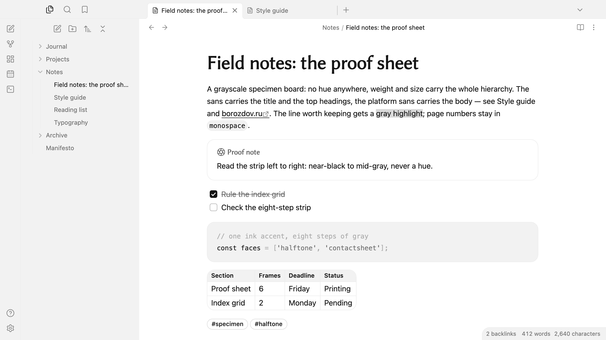
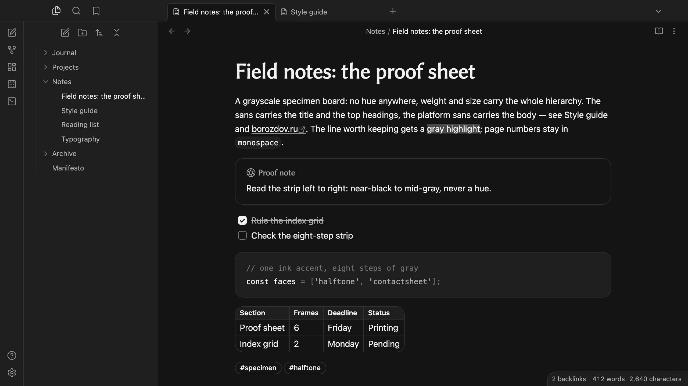

# Borozdov Grayscale

A theme from the Borozdov collection. Two faces — light **Halftone**, a printer's proof
sheet under a loupe, and dark **Contactsheet**, the same sheet read off a lightbox after
the room goes dark. No hue anywhere: near-black ink is the only "color" on the page, and
every other value is a step of gray. Hierarchy is carried by weight and size alone — a
grayscale specimen board, not a palette.

## Principles

- **One ink, no hues.** Near-black carries every link, the caret, tag outlines and the
  filled button on Halftone; Contactsheet inverts it to a near-white ink on a near-black
  page. Nothing on either face is a color in the ordinary sense — it is all steps of gray.
- **A label, not a headline.** Linux Biolinum, a humanist sans, sets the title and the top
  two heading levels a size up with tight negative tracking; h3 down to the smallest
  heading, and all body text, stay in the platform's own sans. h5 and h6 drop to small
  tracked capitals, like a caption under a swatch, and bold text never passes 600 — this
  theme's source material never goes heavier than a fraction past semibold.
- **A printed grayscale strip stands in for color.** Code tokens and callout severity are
  told apart the same way a photographer reads a step wedge: eight steps from near-black to
  mid-gray, never eight colors. A callout is a plain 16px card with a hairline border; the
  label and the icon are the only thing that changes between a note and a warning.
- **Two corners, nothing between.** Every button, tag and search field rounds to a full
  pill; cards and code round a soft 16px; modals round 24px. Cards never cast a shadow —
  only a floating menu or dropdown lifts off the page, and only on Halftone, where there is
  still light left to cast one.
- **A contact-sheet table.** Tables draw their own hairline frame and inner grid, ruled like
  a proof sheet's index grid rather than boxed like a spreadsheet.

## Features

- Light and dark modes, following Settings → Appearance → Base color scheme
- Callouts as flat, hairline-bordered cards with soft 16px corners; every type reads the
  same shape, distinguished only by its label and icon on the gray strip
- Blockquotes in the embedded sans, a size up, behind a stronger gray rule
- Tables ruled like a proof sheet's index grid, with a tinted header and a hairline frame,
  no doubled edge
- Tags and buttons as a full-pill ink outline, filled solid only for the one action that
  matters
- Quiet editing: no focus ring around the note, its title or form fields while you type;
  property names read as labels, not boxed fields
- Text colours meet WCAG contrast on both faces
- The phone layout keeps the same shapes and the same gray strip
- No `!important`: every rule can be overridden with a CSS snippet

## Installation

**From the community directory, as a variant:** this theme ships inside **Borozdov
Utility**. Install Borozdov Utility under Settings → Appearance → Themes → Manage, then
the [Style Settings](https://github.com/mgmeyers/obsidian-style-settings) plugin, and
choose **Grayscale** under Style Settings → Borozdov Utility → Variant. The variant brings
this theme's palette, type and corners; its own layout, and its embedded font if it has
one, come with the full theme below.

**The full theme, by hand:** download `manifest.json` and `theme.css` from the
[latest release](https://github.com/borozdov-obsidian-themes/grayscale/releases/latest)
into `<vault>/.obsidian/themes/Borozdov Grayscale/`, then choose Borozdov Grayscale under
Settings → Appearance → Themes.

## Font

Linux Biolinum is embedded in `theme.css` as base64 WOFF2 under the SIL Open Font License
1.1 — see [`fonts/OFL.txt`](fonts/OFL.txt). It is a Latin and Cyrillic subset of the
original release by Philipp H. Poll, kept under its own name: the font's source and license
declare no Reserved Font Name, so no renaming was needed. One weight, for the title and the
top two heading levels only.

## License

MIT — see [LICENSE](LICENSE).

---

**По-русски.** Тема из коллекции Borozdov. Два лика: светлый «Halftone» — печатный пробный
лист под лупой, и тёмный «Contactsheet» — тот же лист на подсветке после того, как в
комнате погас свет. Ни одного оттенка: единственный «цвет» на странице — почти чёрные
чернила, всё остальное — ступени серого. Гуманистический рубленый Linux Biolinum несёт
заголовок и два верхних уровня подзаголовков, платформенный шрифт — всё остальное.
В каталоге тема живёт вариантом Borozdov Utility: установите Borozdov Utility и плагин Style Settings, затем выберите Grayscale в Style Settings → Borozdov Utility → Variant. Целиком, со своей вёрсткой, тема ставится вручную из последнего релиза репозитория.
